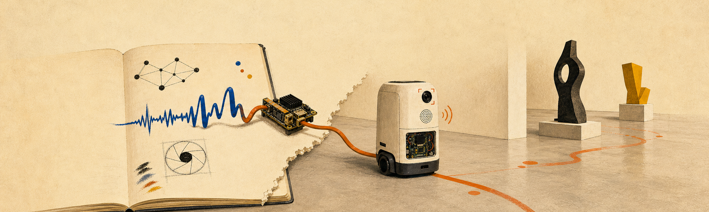

  <a href="https://praysimanjuntak.com">portfolio</a> ·
  <a href="https://huggingface.co/praysimanjuntak">hugging face</a> ·
  <a href="https://linkedin.com/in/pray-apostel">linkedin</a> ·
  <a href="mailto:simanjuntakpray@gmail.com">email</a>

I build AI systems that have to work outside a notebook—real-time voice agents on robots, edge inference, reasoning models, and small products people can actually use.

A few things I've built:

- 🧠 [**Qwen3.5-4B GRPO**](https://github.com/praysimanjuntak/qwen3.5-4b-grpo-gsm8k) — post-training with verifiable rewards that lifted GSM8K pass@1 from 85.4% to 92.4%
- 🔎 [**Deepfake Detection**](https://github.com/praysimanjuntak/deepfake-detection) — an explainable image-forensics toolkit combining a learned classifier with ELA, FFT, noise, and EXIF signals
- 📦 [**RAGBox**](https://github.com/praysimanjuntak/ragbox) — a local-first RAG command-line tool, packaged for `pip install ragbox`
- 📉 [**Transformer Crypto**](https://github.com/praysimanjuntak/transformer_crypto) — eleven experiments asking whether transformers can predict markets; the honest answer was more interesting than the optimistic one

Previously, I shipped a real-time voice agent with ~20 tools across 10+ tour-guide robots, and brought speech and vision models onto edge hardware. These days I'm exploring RL post-training, auditable multimodal systems, and software that earns a permanent browser tab.

`Python` · `PyTorch` · `TypeScript` · `FastAPI` · `React` · `Docker` · `Jetson`

I write up the useful parts—including the experiments that fail—on [Substack](https://substack.com/@praysimanjuntak).
